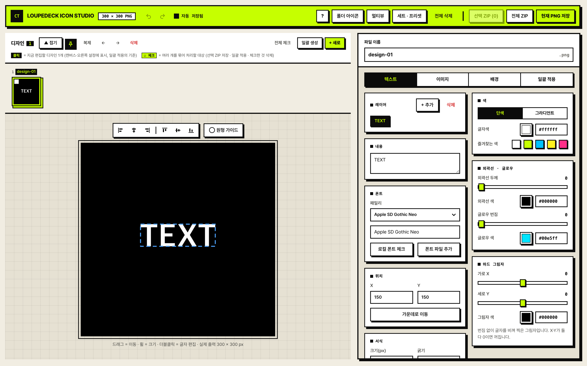

# LOUPEDECK ICON STUDIO

  Loupedeck CT의 버튼·다이얼 화면에 들어갈 300×300 아이콘을 브라우저에서 바로 만드는 웹 도구입니다. 
  글자·이미지·배경을 꾸미고, 여러 장을 한 번에 만들어 PNG·ZIP으로 내려받을 수 있습니다.

  

  
  
  
  
  

## 기능

### 디자인

| 기능 | 설명 |
|---|---|
| 글자 | 로컬 폰트·폰트 파일, 굵기·자간·줄 간격(기본 1.25), 단색·그라디언트, 외곽선, 글로우, 하드 그림자 |
| 배경 | 투명·단색·그라디언트, 칸 안쪽 테두리 |
| 칸에 꽉 맞춤 | 글자가 300×300 안에 차도록 크기 자동 조절 |
| 이미지 | 업로드·끌어다 놓기·붙여넣기(⌘/Ctrl+V), 크롭·크기·회전 |
| 원형 가이드 | 다이얼(원형 화면)에 실제로 보이는 영역 표시 |
| 폴더 아이콘 | 맥 Finder용 유리 질감 폴더 아이콘(1024×1024 투명 PNG). "이미지 복사" 후 정보 가져오기(⌘I) 창 아이콘에 ⌘V |

### 멀티 이미지 생성 및 관리

| 기능 | 설명 |
|---|---|
| 일괄 생성 | 글을 줄·빈 줄·구분 기호로 나누거나 이미지 여러 장으로 한 번에 생성. 넘치는 글자는 자동 축소 |
| 일괄 적용 | 고른 설정 항목만 체크한 디자인(또는 전체)에 복사. 적용할 레이어 선택, 스타일 초기화 |
| 스타일 프리셋 | 글자·배경 스타일을 이름 붙여 저장하고 적용. 기본 제공 **기본**·**브루탈리즘** |
| 프레임 | 디자인을 한 줄 10개씩 나열. 접기·핀 고정, 끌어서 순서 변경, Shift+클릭 범위 체크, 체크한 것 삭제 |
| 멀티뷰 | 디자인을 한 화면에 크게 모아 보기. 크기·배경·모양(사각·둥근 사각·원형) 변경, 누르면 편집 |

> **클릭** = 지금 편집할 디자인 1개(일괄 적용의 기준) · **체크** = 묶어서 처리할 대상(선택 ZIP·일괄 적용·삭제)

### 저장 · 내보내기

| 기능 | 설명 |
|---|---|
| 자동 저장 | 작업·이미지·추가한 폰트·프리셋을 브라우저에 저장. 새로고침해도 유지 |
| 세트 파일 | 디자인·이미지·폰트·프리셋을 `.ctset.json` 하나로 저장. 다른 브라우저·기기에서 불러오기 |
| 실행 취소 | 최근 100단계 |
| 내보내기 | 현재 PNG, 체크한 것 ZIP, 전체 ZIP |

## 단축키

| 키 | 동작 |
|---|---|
| 드래그 | 레이어 이동 (Alt = 자석 끄기) |
| 휠 | 글자·이미지 크기 |
| 더블클릭 | 글자 내용 편집 |
| 방향키 | 1px 이동 (Shift = 10px) |
| Delete | 선택한 레이어 삭제 |
| ⌘/Ctrl+Z · ⇧⌘/Ctrl+Z | 실행 취소 · 다시 실행 |
| ⌘/Ctrl+D | 디자인 복제 |
| ⌘/Ctrl+S | 현재 PNG 저장 |
| PageUp · PageDown | 이전 · 다음 디자인 |

## 알아 둘 점

- 자동 저장은 이 브라우저 안에만 남습니다. 다른 브라우저·기기로 옮기려면 세트 파일로 저장해 불러오세요. 브라우저 데이터를 지우면 자동 저장본도 함께 사라집니다.
- 세트 파일에는 직접 추가한 폰트 파일만 들어갑니다. 컴퓨터에 설치된 폰트는 불러오는 기기에도 설치돼 있어야 같은 모양으로 보입니다.
- 로컬 폰트 목록은 브라우저가 폰트 접근 권한을 줄 때만 전부 불러옵니다. 권한 팝업을 띄우지 않는 브라우저(예: Aside)에서는 흔한 폰트 중 설치된 것만 찾아 목록에 넣습니다. 그 외 폰트는 이름을 직접 입력하거나 폰트 파일을 추가하세요.
